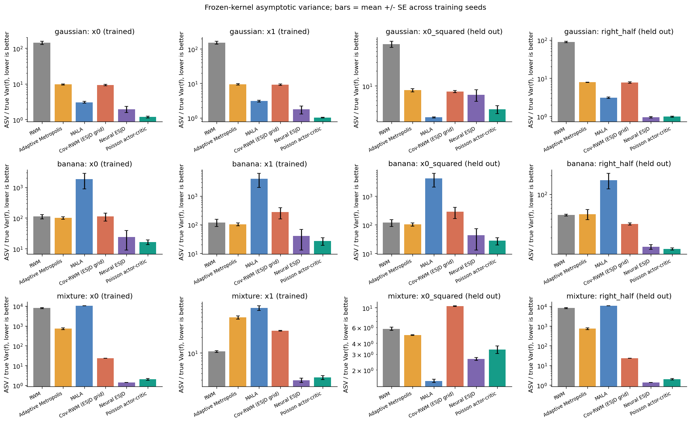
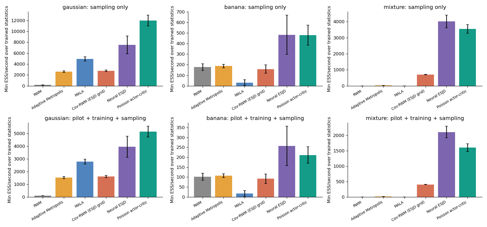
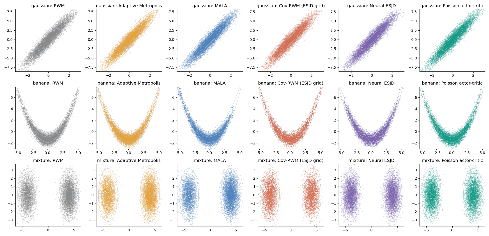
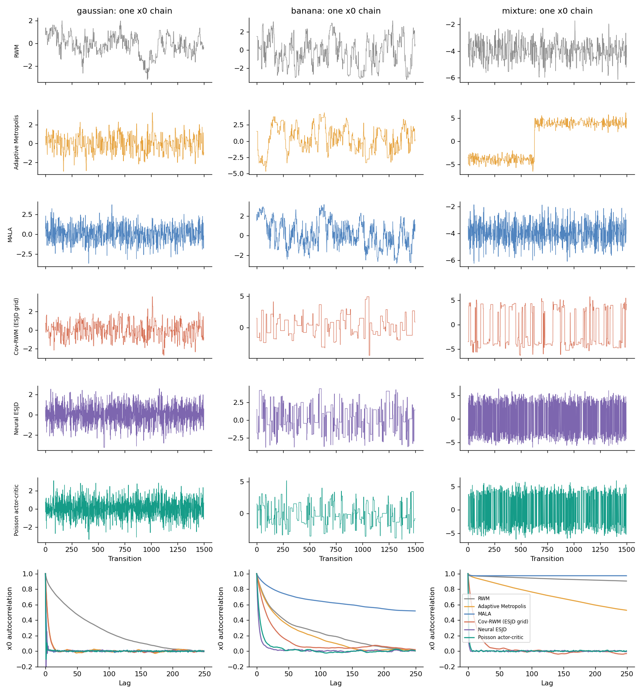
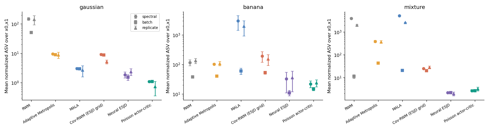
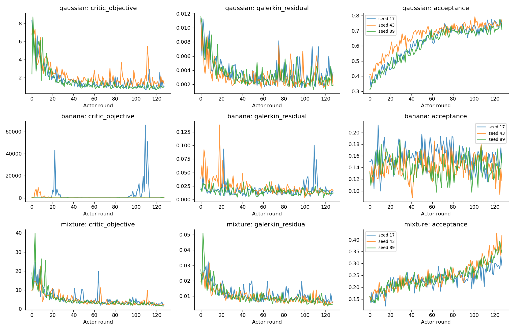
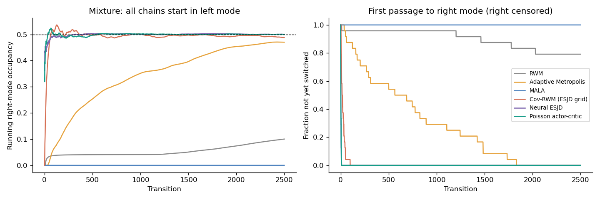
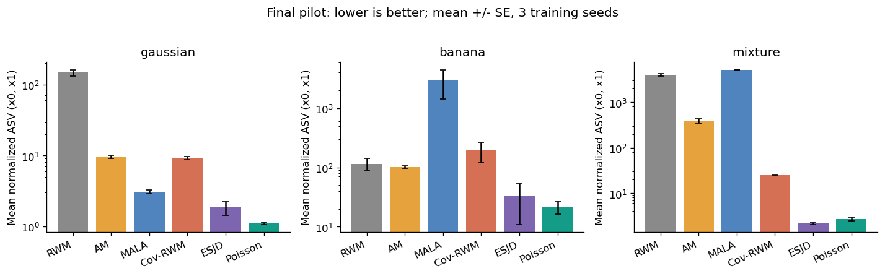

# 最终预实验比较（第二轮 + 经典步长敏感性检查）

训练后的固定 kernel，以两个训练统计函数归一化渐近方差的平均作为汇总指标；越低越好。这里只做探索性预实验，第二轮参数根据第一轮观察调整，未进行独立确认性检验。学习方法使用最终修正的成对链分组；经典方法复用第二轮结果（该修正不涉及经典方法）。

| 任务 | 方法 | 平均归一化 ASV ± SE | 最小 ESS/s（含训练） | 最差 R-hat |
|---|---|---:|---:|---:|
| gaussian | RWM | 147.56 ± 15.42 | 100.9 | 1.035 |
| gaussian | Adaptive Metropolis | 9.55 ± 0.44 | 1533.0 | 1.002 |
| gaussian | MALA | 3.05 ± 0.17 | 2778.8 | 1.001 |
| gaussian | Cov-RWM (ESJD grid) | 9.22 ± 0.42 | 1608.2 | 1.002 |
| gaussian | Neural ESJD | 1.85 ± 0.42 | 3959.6 | 1.002 |
| gaussian | Poisson actor-critic | 1.10 ± 0.04 | 5146.2 | 1.001 |
| banana | RWM | 115.38 ± 25.68 | 102.3 | 1.037 |
| banana | Adaptive Metropolis | 102.20 ± 5.29 | 107.2 | 1.033 |
| banana | MALA | 2945.70 ± 1513.20 | 17.5 | 1.230 |
| banana | Cov-RWM (ESJD grid) | 192.57 ± 73.78 | 92.1 | 1.024 |
| banana | Neural ESJD | 32.41 ± 21.50 | 257.5 | 1.017 |
| banana | Poisson actor-critic | 21.79 ± 5.51 | 211.6 | 1.007 |
| mixture | RWM | 3990.24 ± 258.43 | 1.3 | 5.812 |
| mixture | Adaptive Metropolis | 388.73 ± 39.01 | 14.0 | 1.177 |
| mixture | MALA | 5231.13 ± 9.58 | 0.7 | >10⁶（未混合） |
| mixture | Cov-RWM (ESJD grid) | 25.00 ± 0.35 | 403.9 | 1.009 |
| mixture | Neural ESJD | 2.17 ± 0.13 | 2108.2 | 1.001 |
| mixture | Poisson actor-critic | 2.68 ± 0.24 | 1600.8 | 1.001 |

Cov-RWM 使用共同 pilot 的协方差，在8个尺度候选上用训练期 ESJD 选择尺度；总训练转移预算与第二轮其他方法相同，没有调用解析矩或独立目标采样器选尺度。

R-hat >1.01 的结果须谨慎解释；明显未混合的经典链，其短链 ASV 不能看作真实渐近方差，不应把由此形成的巨大比值当成可靠速度提升。

## Poisson 的相对观测结果

- gaussian：相对本次估计最低的经典对照 MALA，ASV 观测比 2.78×；相对同架构 ESJD，1.68×。
- banana：相对本次估计最低的经典对照 Adaptive Metropolis，ASV 观测比 4.69×；相对同架构 ESJD，1.49×。
- mixture：相对本次估计最低的经典对照 Cov-RWM (ESJD grid)，ASV 观测比 9.33×；相对同架构 ESJD，0.81×。

## 一次受控迭代

v1→v2：每批步数16→32、轮数96→128、Actor LR 0.012→0.008、Critic ridge 0.001→0.003。所有对照同步增加训练转移预算，使用相同种子；最终又修正了与双峰初始分配重合的奇偶链拆分。多个因素同时改变，因此不能拆分各因素贡献。早期结果只作为开发过程记录。

| 任务 | v1 Poisson 平均归一化 ASV | v2 Poisson 平均归一化 ASV |
|---|---:|---:|
| gaussian | 1.17 | 1.10 |
| banana | 81.70 | 21.79 |
| mixture | 2.74 | 2.68 |

详细科学解读见项目 `docs/FINDINGS.md`；完整逐次指标在各输入实验目录的 metrics.csv。

## 图

