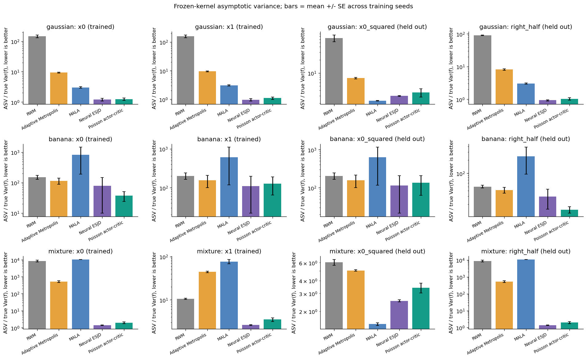
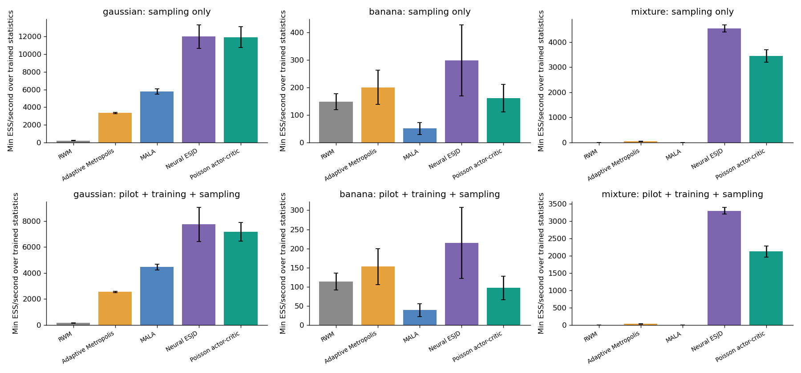
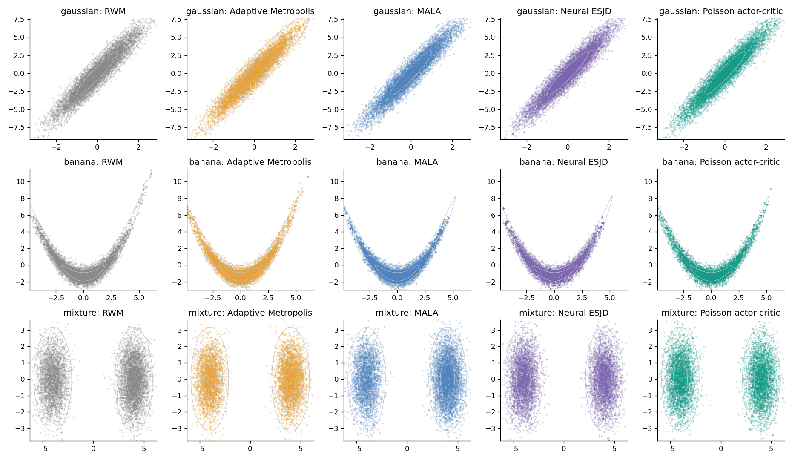
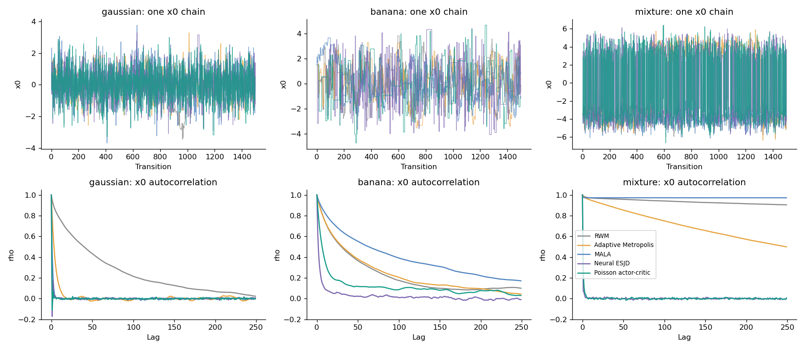
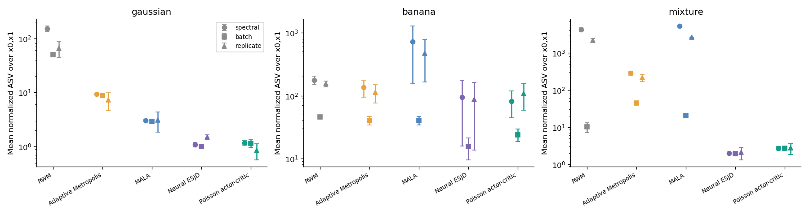
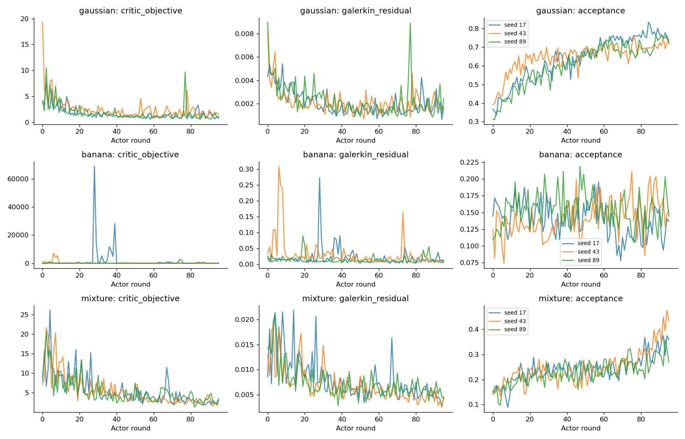
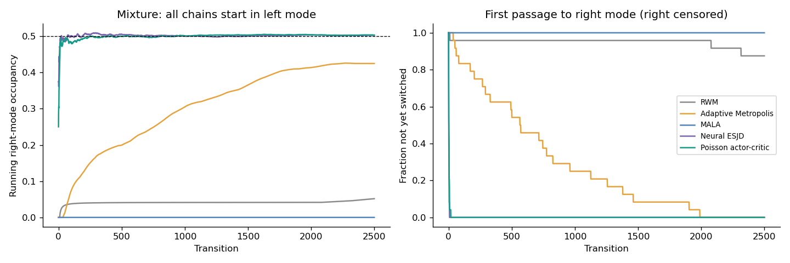

# Poisson Critic / MH Policy Gradient 预实验结果

训练随机种子：[17, 43, 89]；每个冻结 kernel 独立评估 8 条链，每条 5000 步；3 个任务、5 种方法。

数值均为跨训练种子的均值 ± 标准误（SE）；样本少，不能当作确定性排名。主表的 ASV 除以统计函数真实边际方差，越低越好。x0、x1 用于训练，x0² 和右半空间指示函数仅用于评估。

## gaussian

| 方法 | x0 归一化 ASV | x1 归一化 ASV | x0² 归一化 ASV | 最差 R-hat | 最小 ESS/s（含训练） |
|---|---:|---:|---:|---:|---:|
| RWM | 146.55 ± 16.15 | 158.46 ± 18.20 | 63.90 ± 11.24 | 1.037 | 156.8 |
| Adaptive Metropolis | 9.40 ± 0.34 | 9.41 ± 0.38 | 7.64 ± 0.29 | 1.004 | 2538.1 |
| MALA | 3.03 ± 0.18 | 3.07 ± 0.18 | 2.29 ± 0.02 | 1.001 | 4455.7 |
| Neural ESJD | 1.21 ± 0.12 | 0.97 ± 0.09 | 2.96 ± 0.07 | 1.001 | 7733.0 |
| Poisson actor-critic | 1.24 ± 0.13 | 1.10 ± 0.11 | 3.56 ± 0.77 | 1.001 | 7150.8 |

按 x0、x1 归一化 ASV 的算术平均，Poisson 相对于最强经典对照 MALA 的效率比为 **2.60×**（>1 才表示优势）。
相对于相同 neural proposal 的 ESJD 消融，效率比为 **0.93×**。

## banana

| 方法 | x0 归一化 ASV | x1 归一化 ASV | x0² 归一化 ASV | 最差 R-hat | 最小 ESS/s（含训练） |
|---|---:|---:|---:|---:|---:|
| RWM | 151.39 ± 23.40 | 200.42 ± 37.82 | 204.13 ± 38.84 | 1.038 | 113.2 |
| Adaptive Metropolis | 114.61 ± 27.10 | 154.17 ± 54.14 | 156.92 ± 55.96 | 1.033 | 152.8 |
| MALA | 828.20 ± 639.17 | 609.70 ± 491.89 | 633.10 ± 516.83 | 1.235 | 38.9 |
| Neural ESJD | 79.11 ± 69.24 | 109.55 ± 87.64 | 113.88 ± 92.51 | 1.048 | 214.7 |
| Poisson actor-critic | 37.53 ± 13.27 | 125.87 ± 61.90 | 133.88 ± 71.10 | 1.012 | 96.8 |

按 x0、x1 归一化 ASV 的算术平均，Poisson 相对于最强经典对照 Adaptive Metropolis 的效率比为 **1.64×**（>1 才表示优势）。
相对于相同 neural proposal 的 ESJD 消融，效率比为 **1.15×**。

## mixture

| 方法 | x0 归一化 ASV | x1 归一化 ASV | x0² 归一化 ASV | 最差 R-hat | 最小 ESS/s（含训练） |
|---|---:|---:|---:|---:|---:|
| RWM | 8491.30 ± 977.89 | 10.56 ± 0.34 | 6.04 ± 0.40 | 62399679113492.922 | 2.1 |
| Adaptive Metropolis | 521.09 ± 64.23 | 44.34 ± 1.82 | 5.03 ± 0.08 | 1.161 | 32.4 |
| MALA | 10388.95 ± 12.71 | 76.87 ± 8.91 | 1.50 ± 0.05 | 62399679113492.922 | 1.2 |
| Neural ESJD | 1.41 ± 0.07 | 2.60 ± 0.06 | 2.53 ± 0.06 | 1.001 | 3291.4 |
| Poisson actor-critic | 1.97 ± 0.24 | 3.50 ± 0.34 | 3.40 ± 0.37 | 1.001 | 2121.6 |

按 x0、x1 归一化 ASV 的算术平均，Poisson 相对于最强经典对照 Adaptive Metropolis 的效率比为 **103.34×**（>1 才表示优势）。
相对于相同 neural proposal 的 ESJD 消融，效率比为 **0.73×**。

## 解释范围与局限

- 主实验从独立的精确 π 样本开始，仅用于隔离固定 kernel 的平稳态效率；训练和调参完全不调用精确采样器或真实矩。双峰另有全部从左峰出发的压力测试。
- 所有方法使用相同链数、pilot 及 warmup 转移步数；学习方法另有 Actor proposal 和反向传播成本，因此同时报告 ESS/步、ESS/密度调用和包含训练的 ESS/秒。MALA 还使用目标梯度，调用数单列。
- 主 ASV 来自带链间方差修正的 Geyer 序列估计；同时提供两种 batch size 的 batch means，以及 N·Var(独立链均值)。后者每个训练种子仅有少量独立链，误差很大；batch 太短会低估慢相关，不能将 Critic 的训练目标当成验证 ASV。
- Critic 为线性/二次/平滑阈值特征加可训练 MLP；末层用带 ridge 的 Galerkin 方程求解。这是原变分目标的有限维正则化近似，不是原无限维 Poisson 方程的精确解。Galerkin residual 只衡量同批次的投影残差，不是全状态空间的 Bellman residual。
- Actor 使用原 MH-specific score、独立 proposal 批次和冻结 Critic；当前训练样本的中心化、非稳态、有限 Critic 表达能力、ridge 和正标量归一化都可能影响优化。
- 任务只有二维、训练种子很少，结果只能判断是否值得继续研究，无法支持普遍优于经典 MCMC 的结论。

## 输出文件

- `metrics.csv`：每个任务/方法/种子/统计函数的完整指标。
- `summary.csv`：按训练统计函数汇总的比较。
- `runs/`：逐次配置、历史、冻结参数、样本及诊断，支持追溯。
- `figures/`：ASV、成本、覆盖、轨迹、自相关、训练和冷启动图。

## 图

