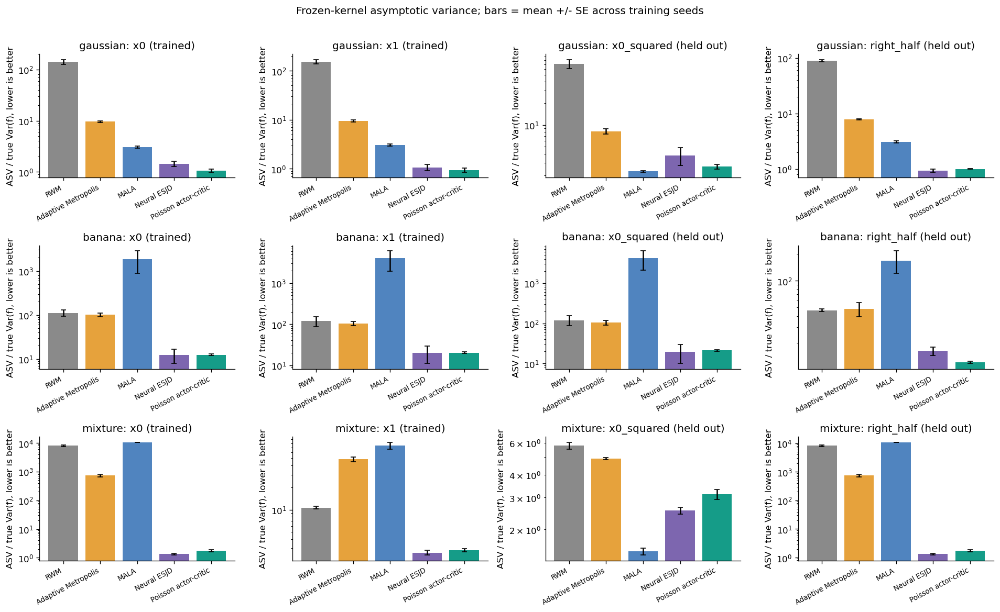
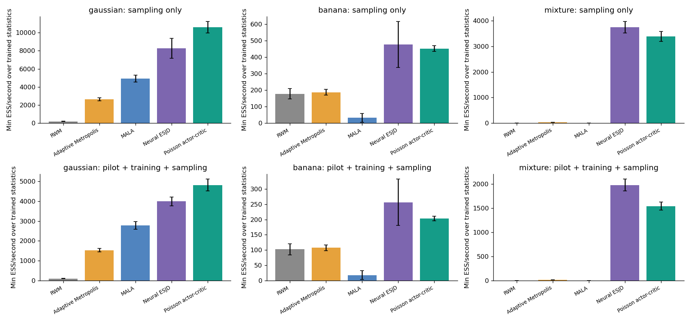
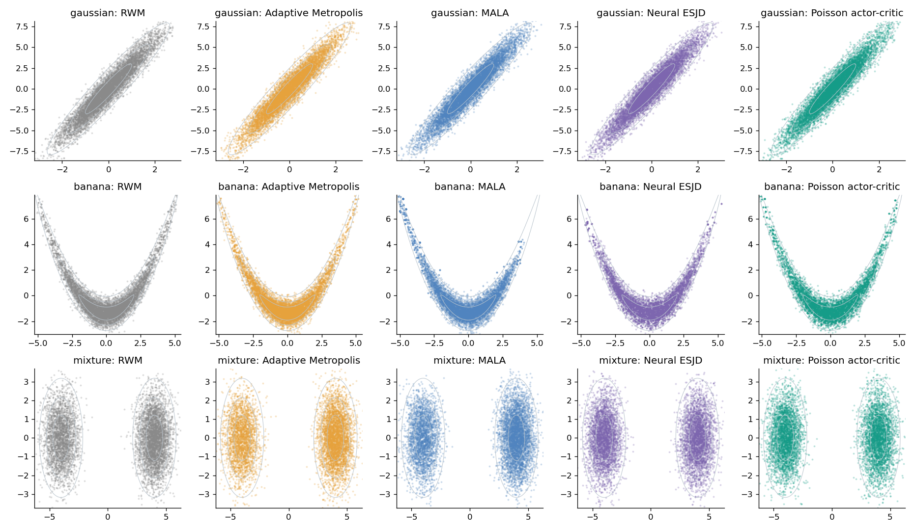
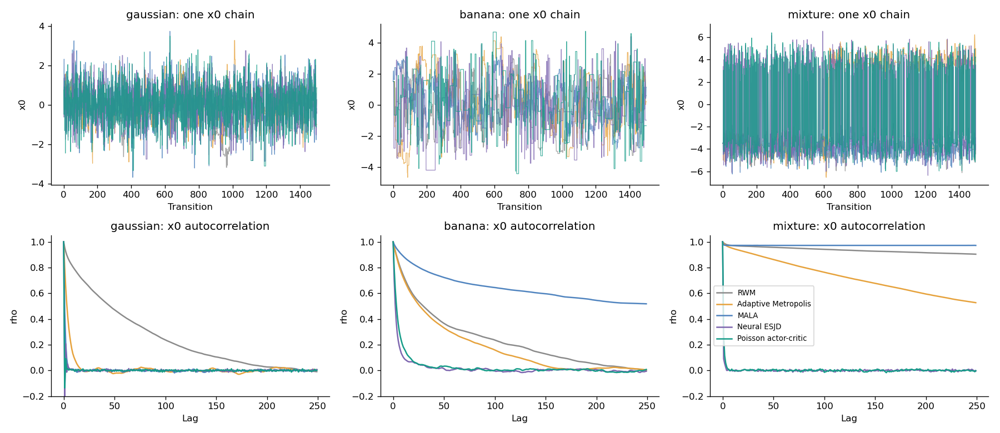
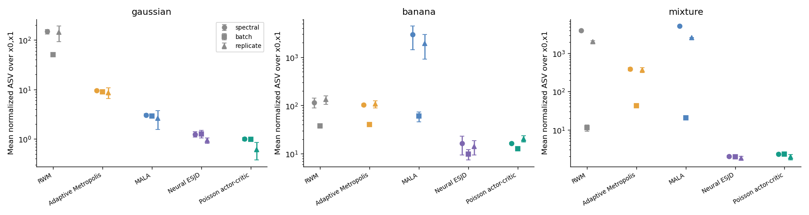
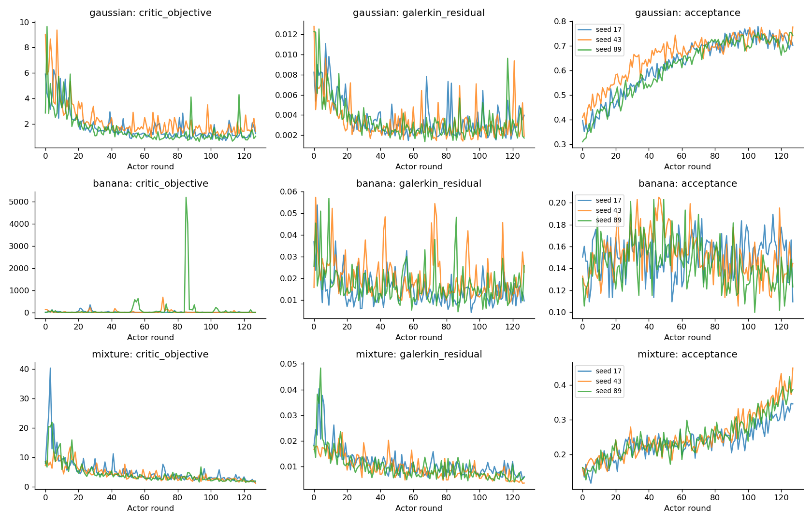
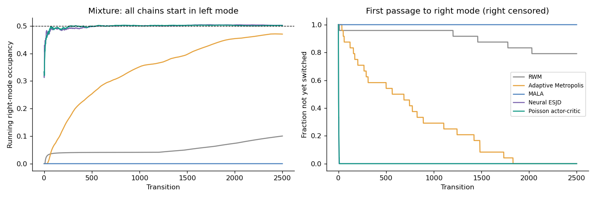

# Poisson Critic / MH Policy Gradient 预实验结果

训练随机种子：[17, 43, 89]；每个冻结 kernel 独立评估 8 条链，每条 5000 步；3 个任务、5 种方法。

数值均为跨训练种子的均值 ± 标准误（SE）；样本少，不能当作确定性排名。主表的 ASV 除以统计函数真实边际方差，越低越好。x0、x1 用于训练，x0² 和右半空间指示函数仅用于评估。

## gaussian

| 方法 | x0 归一化 ASV | x1 归一化 ASV | x0² 归一化 ASV | 最差 R-hat | 最小 ESS/s（含训练） |
|---|---:|---:|---:|---:|---:|
| RWM | 141.76 ± 15.25 | 153.36 ± 15.61 | 71.02 ± 10.21 | 1.035 | 100.9 |
| Adaptive Metropolis | 9.60 ± 0.39 | 9.49 ± 0.49 | 8.16 ± 0.64 | 1.002 | 1533.0 |
| MALA | 3.05 ± 0.17 | 3.06 ± 0.17 | 2.29 ± 0.05 | 1.001 | 2778.8 |
| Neural ESJD | 1.44 ± 0.16 | 1.07 ± 0.15 | 3.80 ± 1.05 | 1.001 | 3996.2 |
| Poisson actor-critic | 1.06 ± 0.06 | 0.94 ± 0.09 | 2.66 ± 0.20 | 1.001 | 4818.0 |

**诊断警示：本任务部分方法/种子的 R-hat >1.01。其短链 ASV 估计及下述效率比不应被视为可靠的真实渐近效率比；应同时检查 ESS、独立链均值误差和冷启动图。**

按 x0、x1 归一化 ASV 的算术平均，Poisson 相对于本次估计值最低的经典对照 MALA 的**观测估计比**为 **3.06×**（>1 表示该指标较好，可靠性须结合诊断）。
相对于相同 neural proposal 的 ESJD 消融，效率比为 **1.26×**。

## banana

| 方法 | x0 归一化 ASV | x1 归一化 ASV | x0² 归一化 ASV | 最差 R-hat | 最小 ESS/s（含训练） |
|---|---:|---:|---:|---:|---:|
| RWM | 111.88 ± 18.47 | 118.88 ± 32.97 | 119.65 ± 33.34 | 1.037 | 102.3 |
| Adaptive Metropolis | 100.91 ± 9.68 | 103.48 ± 12.35 | 103.90 ± 13.39 | 1.033 | 107.2 |
| MALA | 1863.49 ± 975.43 | 4027.92 ± 2062.04 | 4183.56 ± 2110.93 | 1.230 | 17.5 |
| Neural ESJD | 12.38 ± 4.42 | 20.22 ± 9.19 | 19.69 ± 9.65 | 1.010 | 256.4 |
| Poisson actor-critic | 12.50 ± 0.56 | 20.24 ± 1.07 | 21.24 ± 0.92 | 1.007 | 203.1 |

**诊断警示：本任务部分方法/种子的 R-hat >1.01。其短链 ASV 估计及下述效率比不应被视为可靠的真实渐近效率比；应同时检查 ESS、独立链均值误差和冷启动图。**

按 x0、x1 归一化 ASV 的算术平均，Poisson 相对于本次估计值最低的经典对照 Adaptive Metropolis 的**观测估计比**为 **6.24×**（>1 表示该指标较好，可靠性须结合诊断）。
相对于相同 neural proposal 的 ESJD 消融，效率比为 **1.00×**。

## mixture

| 方法 | x0 归一化 ASV | x1 归一化 ASV | x0² 归一化 ASV | 最差 R-hat | 最小 ESS/s（含训练） |
|---|---:|---:|---:|---:|---:|
| RWM | 7969.80 ± 516.72 | 10.68 ± 0.43 | 5.78 ± 0.25 | 5.812 | 1.3 |
| Adaptive Metropolis | 728.87 ± 81.42 | 48.58 ± 3.55 | 4.92 ± 0.07 | 1.177 | 14.0 |
| MALA | 10388.11 ± 13.21 | 74.16 ± 7.83 | 1.51 ± 0.06 | >10⁶（未混合） | 0.7 |
| Neural ESJD | 1.35 ± 0.09 | 2.62 ± 0.18 | 2.54 ± 0.11 | 1.001 | 1980.3 |
| Poisson actor-critic | 1.76 ± 0.14 | 2.83 ± 0.14 | 3.12 ± 0.19 | 1.001 | 1544.2 |

**诊断警示：本任务部分方法/种子的 R-hat >1.01。其短链 ASV 估计及下述效率比不应被视为可靠的真实渐近效率比；应同时检查 ESS、独立链均值误差和冷启动图。**

按 x0、x1 归一化 ASV 的算术平均，Poisson 相对于本次估计值最低的经典对照 Adaptive Metropolis 的**观测估计比**为 **169.49×**（>1 表示该指标较好，可靠性须结合诊断）。
相对于相同 neural proposal 的 ESJD 消融，效率比为 **0.87×**。

## 解释范围与局限

- 主实验从独立的精确 π 样本开始，仅用于隔离固定 kernel 的平稳态效率；训练和调参完全不调用精确采样器或真实矩。双峰另有全部从左峰出发的压力测试。
- 所有方法使用相同链数、pilot 及 warmup 转移步数；学习方法另有 Actor proposal 和反向传播成本，因此同时报告 ESS/步、ESS/密度调用和包含训练的 ESS/秒。MALA 还使用目标梯度，调用数单列。
- 主 ASV 来自带链间方差修正的 Geyer 序列估计；同时提供两种 batch size 的 batch means，以及 N·Var(独立链均值)。后者每个训练种子仅有少量独立链，误差很大；batch 太短会低估慢相关，不能将 Critic 的训练目标当成验证 ASV。
- Critic 为线性/二次/平滑阈值特征加可训练 MLP；末层用带 ridge 的 Galerkin 方程求解。这是原变分目标的有限维正则化近似，不是原无限维 Poisson 方程的精确解。Galerkin residual 只衡量同批次的投影残差，不是全状态空间的 Bellman residual。
- Actor 使用原 MH-specific score、独立 proposal 批次和冻结 Critic；当前训练样本的中心化、非稳态、有限 Critic 表达能力、ridge 和正标量归一化都可能影响优化。
- 任务只有二维、训练种子很少，结果只能判断是否值得继续研究，无法支持普遍优于经典 MCMC 的结论。

## 输出文件

- `metrics.csv`：每个任务/方法/种子/统计函数的完整指标。
- `summary.csv`：按训练统计函数汇总的比较。
- `runs/`：逐次配置、历史、冻结参数、样本及诊断，支持追溯。
- `figures/`：ASV、成本、覆盖、轨迹、自相关、训练和冷启动图。

## 图

