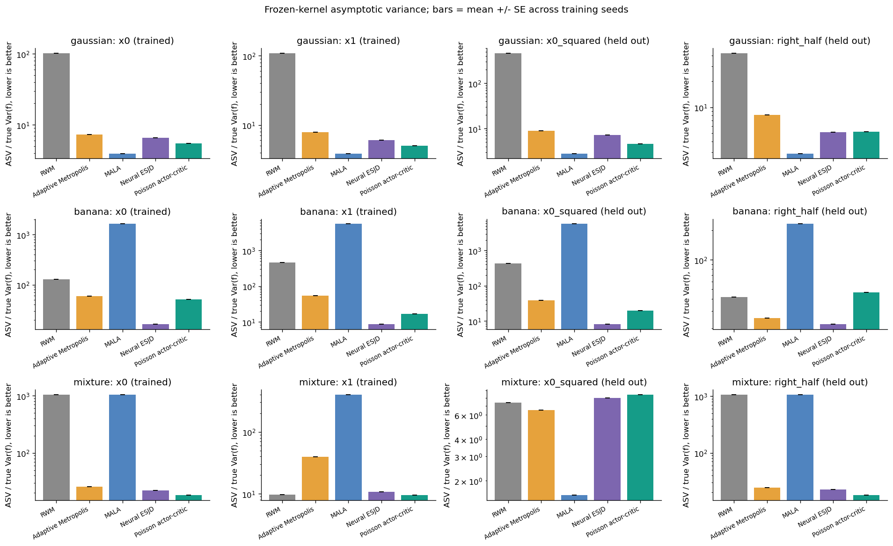
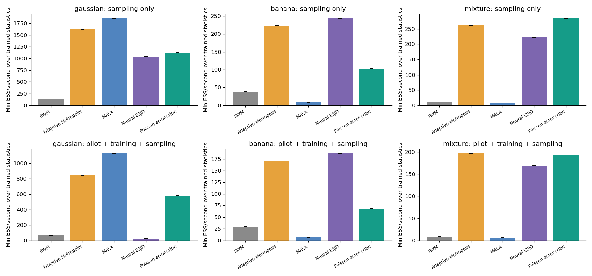
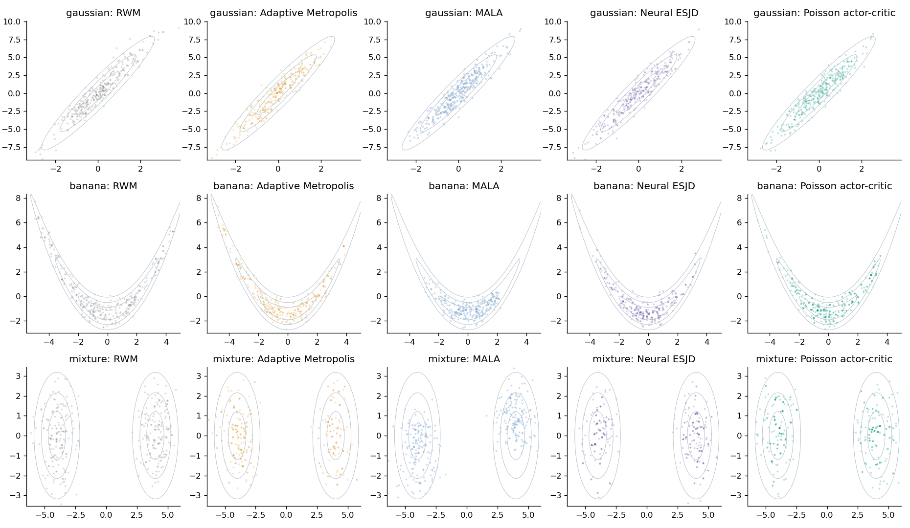
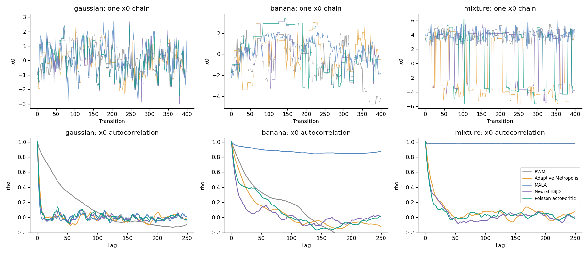
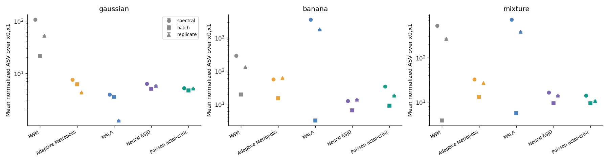
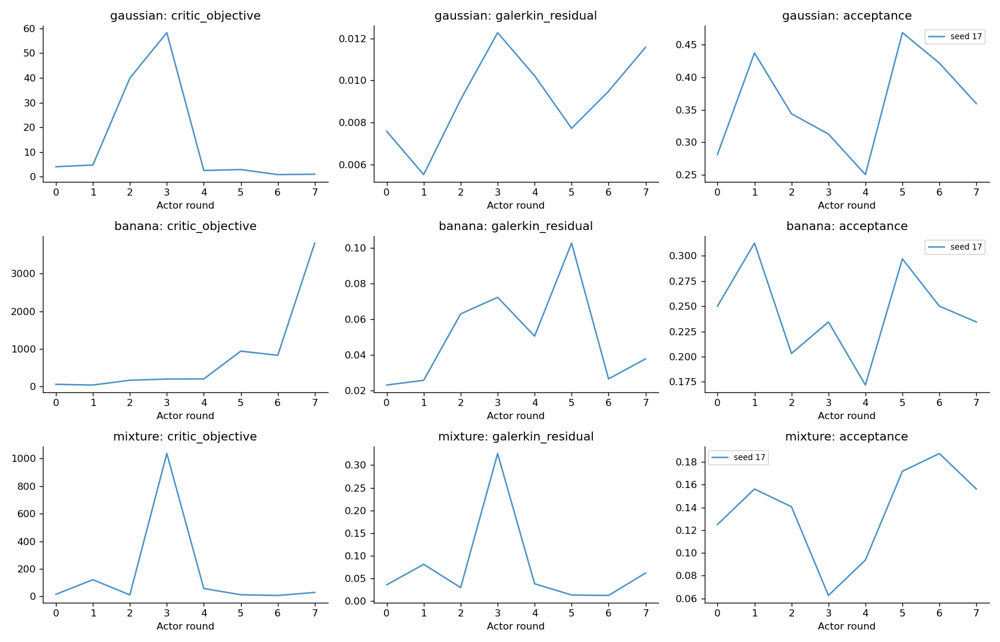
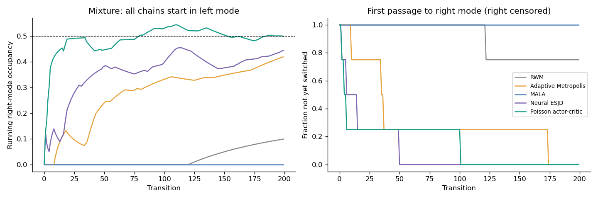

# Poisson Critic / MH Policy Gradient 预实验结果

训练随机种子：[17]；每个冻结 kernel 独立评估 4 条链，每条 400 步；3 个任务、5 种方法。

数值均为跨训练种子的均值 ± 标准误（SE）；样本少，不能当作确定性排名。主表的 ASV 除以统计函数真实边际方差，越低越好。x0、x1 用于训练，x0² 和右半空间指示函数仅用于评估。

## gaussian

| 方法 | x0 归一化 ASV | x1 归一化 ASV | x0² 归一化 ASV | 最差 R-hat | 最小 ESS/s（含训练） |
|---|---:|---:|---:|---:|---:|
| RWM | 102.06 ± 0.00 | 108.83 ± 0.00 | 464.71 ± 0.00 | 1.219 | 67.1 |
| Adaptive Metropolis | 7.35 ± 0.00 | 7.82 ± 0.00 | 8.96 ± 0.00 | 1.021 | 842.3 |
| MALA | 3.96 ± 0.00 | 3.88 ± 0.00 | 2.80 ± 0.00 | 1.008 | 1129.0 |
| Neural ESJD | 6.60 ± 0.00 | 6.08 ± 0.00 | 7.24 ± 0.00 | 1.017 | 24.0 |
| Poisson actor-critic | 5.46 ± 0.00 | 5.02 ± 0.00 | 4.61 ± 0.00 | 1.021 | 577.4 |

按 x0、x1 归一化 ASV 的算术平均，Poisson 相对于最强经典对照 MALA 的效率比为 **0.75×**（>1 才表示优势）。
相对于相同 neural proposal 的 ESJD 消融，效率比为 **1.21×**。

## banana

| 方法 | x0 归一化 ASV | x1 归一化 ASV | x0² 归一化 ASV | 最差 R-hat | 最小 ESS/s（含训练） |
|---|---:|---:|---:|---:|---:|
| RWM | 127.76 ± 0.00 | 457.35 ± 0.00 | 425.91 ± 0.00 | 1.499 | 29.2 |
| Adaptive Metropolis | 58.90 ± 0.00 | 53.72 ± 0.00 | 38.49 ± 0.00 | 1.156 | 170.8 |
| MALA | 1628.17 ± 0.00 | 5551.99 ± 0.00 | 5716.21 ± 0.00 | 1.611 | 7.2 |
| Neural ESJD | 16.27 ± 0.00 | 8.59 ± 0.00 | 8.09 ± 0.00 | 1.106 | 186.6 |
| Poisson actor-critic | 51.33 ± 0.00 | 16.64 ± 0.00 | 19.57 ± 0.00 | 1.167 | 68.5 |

按 x0、x1 归一化 ASV 的算术平均，Poisson 相对于最强经典对照 Adaptive Metropolis 的效率比为 **1.66×**（>1 才表示优势）。
相对于相同 neural proposal 的 ESJD 消融，效率比为 **0.37×**。

## mixture

| 方法 | x0 归一化 ASV | x1 归一化 ASV | x0² 归一化 ASV | 最差 R-hat | 最小 ESS/s（含训练） |
|---|---:|---:|---:|---:|---:|
| RWM | 1034.95 ± 0.00 | 9.76 ± 0.00 | 7.38 ± 0.00 | 1064860298725303.375 | 9.1 |
| Adaptive Metropolis | 25.65 ± 0.00 | 39.68 ± 0.00 | 6.50 ± 0.00 | 1.086 | 196.8 |
| MALA | 1040.47 ± 0.00 | 398.67 ± 0.00 | 1.58 ± 0.00 | 1064860298725303.375 | 6.4 |
| Neural ESJD | 22.29 ± 0.00 | 10.75 ± 0.00 | 7.97 ± 0.00 | 1.068 | 169.4 |
| Poisson actor-critic | 18.36 ± 0.00 | 9.57 ± 0.00 | 8.41 ± 0.00 | 1.067 | 193.4 |

按 x0、x1 归一化 ASV 的算术平均，Poisson 相对于最强经典对照 Adaptive Metropolis 的效率比为 **2.34×**（>1 才表示优势）。
相对于相同 neural proposal 的 ESJD 消融，效率比为 **1.18×**。

## 解释范围与局限

- 主实验从独立的精确 π 样本开始，仅用于隔离固定 kernel 的平稳态效率；训练和调参完全不调用精确采样器或真实矩。双峰另有全部从左峰出发的压力测试。
- 所有方法使用相同链数、pilot 及 warmup 转移步数；学习方法另有 Actor proposal 和反向传播成本，因此同时报告 ESS/步、ESS/密度调用和包含训练的 ESS/秒。MALA 还使用目标梯度，调用数单列。
- 主 ASV 来自带链间方差修正的 Geyer 序列估计；同时提供两种 batch size 的 batch means，以及 N·Var(独立链均值)。后者每个训练种子仅有少量独立链，误差很大；batch 太短会低估慢相关，不能将 Critic 的训练目标当成验证 ASV。
- Critic 为线性/二次/平滑阈值特征加可训练 MLP；末层用带 ridge 的 Galerkin 方程求解。这是原变分目标的有限维正则化近似，不是原无限维 Poisson 方程的精确解。Galerkin residual 只衡量同批次的投影残差，不是全状态空间的 Bellman residual。
- Actor 使用原 MH-specific score、独立 proposal 批次和冻结 Critic；当前训练样本的中心化、非稳态、有限 Critic 表达能力、ridge 和正标量归一化都可能影响优化。
- 任务只有二维、训练种子很少，结果只能判断是否值得继续研究，无法支持普遍优于经典 MCMC 的结论。

## 输出文件

- `metrics.csv`：每个任务/方法/种子/统计函数的完整指标。
- `summary.csv`：按训练统计函数汇总的比较。
- `runs/`：逐次配置、历史、冻结参数、样本及诊断，支持追溯。
- `figures/`：ASV、成本、覆盖、轨迹、自相关、训练和冷启动图。

## 图

